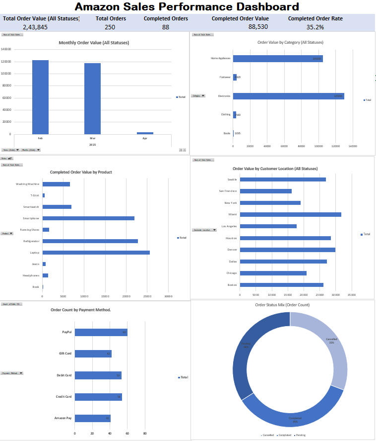

# Amazon Sales Performance Analysis | Microsoft Excel

[Download the Excel workbook](Amazon_Sales_Performance_Analysis.xlsx)

## 1. Project Overview

This project analyzes order-level sales data using Microsoft Excel. It examines order value and status across products, categories, customer locations, payment methods, and months.

The workbook includes a cleaned data table, calculated columns, PivotTables, PivotCharts, an Excel dashboard, and a summary of findings and recommendations.

## 2. Business Problem

A seller wants to understand how orders perform across products and customer segments. The analysis focuses on questions such as:

- Which categories and products have the highest order value?
- How many orders are Completed, Pending, or Cancelled?
- Which customer locations and payment methods have the most orders or order value?
- How do order counts and order value vary by month?

## 3. Project Objectives

- Inspect and validate the source data.
- Calculate monthly labels and verify sales amounts.
- Analyze orders using Excel formulas and PivotTables.
- Build a dashboard with key metrics and charts.
- Summarize findings and recommend follow-up actions.

## 4. Dataset Description

The dataset contains **250 order records** and **11 original columns**. The records run from **February 2 to April 2, 2025**.

### Original columns

Order ID, Date, Product, Category, Price, Quantity, Total Sales, Customer Name, Customer Location, Payment Method, and Status.

### Calculated columns

- **Month:** Displays the month and year for each order.
- **Sales Check:** Confirms whether `Total Sales = Price × Quantity`.

## 5. Tools and Excel Features

- Microsoft Excel
- Excel Tables
- Excel formulas
- Data validation and quality checks
- PivotTables and PivotCharts
- Dashboard charts and filter controls

## 6. Data Preparation and Quality Checks

The data was converted into an Excel Table named `SalesData`. The following checks were completed:

- Checked all 250 records for blank values.
- Checked for duplicate Order IDs.
- Confirmed the dates were valid.
- Verified that `Total Sales` matched `Price × Quantity` for every record.

All 250 rows passed the Sales Check formula.

## 7. Dashboard and KPIs

The dashboard includes these key metrics:

- **Total Orders:** 250
- **Total Order Value, all statuses:** 243,845
- **Completed Orders:** 88
- **Completed Order Value:** 88,530
- **Completed Order Rate:** 35.2%

The dashboard contains charts for monthly order value, order value by category, completed order value by product, order value by customer location, order count by payment method, and order status mix.

## 8. Key Findings

### Order status

- 88 orders were Completed (35.2%).
- 85 were Pending (34.0%).
- 77 were Cancelled (30.8%).

The dataset shows status counts and values, but does not include reasons for pending or cancelled orders.

### Category performance

- Electronics: 129,950
- Home Appliances: 105,000
- Together, these categories account for about **96.4%** of total order value.

### Product performance

Across all statuses, Refrigerator had the highest order value at **78,000**, followed by Laptop at **58,400**.

For Completed orders, Laptop had the highest product order value at **25,600**.

### Customer location

- Miami had the highest order value at **31,700**.
- San Francisco had the lowest at **16,195**.

### Payment methods

PayPal was the most frequently used payment method, with **60 orders**.

### Monthly trend

- February: 113 orders and 122,695 in order value.
- March: 131 orders and 117,730 in order value.
- April: 6 orders and 3,420 in order value, through April 2.

The data starts on February 2 and ends on April 2, so February and April are partial periods.

## 9. Recommendations

- Investigate pending orders and record the causes of cancellations and delays.
- Check inventory and product margins before using order value to guide stock or promotion decisions.
- Compare complete months and collect more data before drawing conclusions about trends.
- Compare payment methods by order status to understand order outcomes.

## 10. Limitations

- The source dataset does not specify a currency.
- Total order value includes Completed, Pending, and Cancelled orders unless a status filter is applied.
- The dataset covers February 2 through April 2, 2025; February and April are partial periods.
- Product costs, profit, refunds, and reasons for order delays or cancellations are not provided.

## 11. Conclusion

This project demonstrates how Excel formulas, PivotTables, PivotCharts, and dashboard filters can be used to analyze order data and communicate business findings.

The analysis highlights category concentration, order status patterns, product performance, and differences across locations, payment methods, and months. Further investigation of order outcomes, product margins, and complete time periods would help support stronger business decisions.

## 12. Skills Demonstrated

- Microsoft Excel
- Data checking and validation
- Excel formulas
- PivotTables and PivotCharts
- Dashboard development
- Data visualization
- Business analysis
- Insight communication

**Project:** Amazon Sales Performance Analysis  
**Tool:** Microsoft Excel  
**Author:**K.Ragapriya
